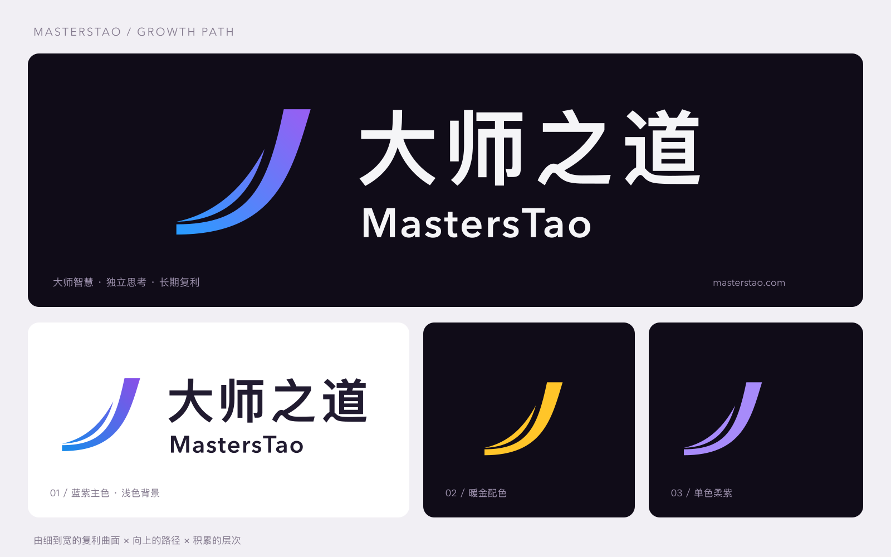

# MastersTao · 大师持仓洞察 —— 系列视觉体系

本目录是 MastersTao 账号视频的统一品牌规范。**本系列不使用主分支的「巴芒价值」角标**，一律使用 `logo-kit/` 中的官方 MastersTao v4 素材（蓝紫复利主色）。



## 1. 资产

| 文件 | 用途 |
|---|---|
| `logo-kit/blue/logo-dark.png/.svg` | 主 logo（mark + 大师之道 + MastersTao），深色背景，**默认使用** |
| `logo-kit/blue/mark.png/.svg` | 独立图形（复利曲面），用于头像、水印、小尺寸 |
| `logo-kit/blue/logo-en-dark.*` | 英文横版 |
| `logo-kit/gold/`、`logo-kit/purple/` | 备用配色（暖金、单色柔紫），仅在特殊主题使用 |
| `logo-kit/README.md` | 官方 logo 说明（理念、配色值） |
| `mt_brand.py` | Python 合成模块：`Hud`（角标）、`PALETTE`（色板）、`TAGS`（事实/背景/推测标签）、`load_logo` |

所有 logo 像素直接取自官方 PNG，**不重绘、不改形、不加描边**。

## 2. 色板（`PALETTE`）

| 名称 | 色值 | 用途 |
|---|---|---|
| bg0 | `#05060C` | 画面底色（近黑偏蓝） |
| bg1 | `#0B0E1C` | 面板 |
| ink / ink2 / ink3 | `#F5F5F7` / `#A9AEC4` / `#5E6480` | 主文字 / 次文字 / 注释网格（ink 与官方字标同色） |
| brand_a → brand_b | `#279DFF` → `#9560F3` | 品牌渐变：分割线、进度、片尾光晕 |
| series_a | `#FFC529` | 数据系列 A（暖金，取自官方 gold 配色） |
| series_b | `#3FC8FF` | 数据系列 B（冰蓝） |
| series_ab | `#B48CFF` | 合并 / 交集（品牌紫） |
| up / down | `#FF5A6A` / `#2FD39A` | A 股习惯：红增绿减 |
| warn | `#FFB547` | 数据不完整 / 推测 |

每期固定：**对比的两类机构 = 暖金 vs 冰蓝，合并 = 紫**。EP01 中汇金 = 暖金，证金 = 冰蓝。

## 3. 字体

| 角色 | 字体 |
|---|---|
| 中文标题 | Noto Sans SC Black / Bold |
| 中文正文 | Noto Sans SC Medium / Regular |
| 数字（玻璃数字、坐标轴） | Inter Display SemiBold / Bold，数字等宽排版（tabular） |

竖屏 1080×1920 最小字号：正文 ≥ 30px，注释 ≥ 21px，标题 ≥ 58px。

## 4. 角标（HUD）

- 位置：右上角，距右 44px、距上 64px（避开平台状态栏）；logo 高 64px。
- logo 下方居右：品牌渐变细线 + 小字「大师持仓洞察」（Noto Sans SC Medium 20px，字距 6px，ink2）。
- logo 后一层很淡的蓝紫光晕；底下垫淡暗阴影，亮画面也清楚。
- 流光：每 8 秒一次，持续 1.2 秒，只扫过 mark 图形。
- 片尾出现大 logo 时角标淡出。

```python
import sys; sys.path.insert(0, 'MastersTao/brand')
from mt_brand import Hud
hud = Hud(width=1080)
hud.draw(frame, t)            # frame: float32 RGB 0..1
```

## 5. 画面语言

- **数据是主角**：玻璃质感数字（上亮下透渐变 + 投影 + 辉光）、磨砂玻璃面板（背景模糊 + 顶边高光 + 发光描边）、三维玻璃柱、粒子矩阵（一个点 = 一家公司）。
- **区分事实与推测**：注释卡片左侧必须带标签胶囊——`事实`（白）、`背景`（冰蓝）、`相关`（紫）、`推测`（橙）、`注意`（红）。
- 每期固定结构：开场悬念（真实数字）→ 标题重拍 → 01 认识主体 → 02 时间线 → 03 全景图 → 04 给普通投资者 → 品牌片尾。
- 左上角章节标签：`01 认识…`，品牌蓝细线下划。
- 底部数据来源脚注常驻于数据段落。

## 6. 声音

- 原创合成配乐（无版权风险），深沉低频 + 弦乐铺底 + 固定音型；季度/数据切换落在小节线上。
- 转场只用低频脉冲、Sub Drop、深沉轰鸣；**不用高频 Whoosh 与白噪声**。
- 全片无配音，靠音乐与文字叙事。

## 7. 品牌片尾（每期复用）

1. 低速品牌光环 + 星云背景，重拍闪光进入；
2. 官方 logo（高 230px）从左向右扫光揭示，mark 后有蓝紫光晕；
3. 「大师持仓洞察」+ 品牌渐变细线；
4. 关注语（本期）：**关注 MastersTao，看懂机构持仓背后的投资逻辑。**
5. 期号与标题、`masterstao.com`。

实现见 `ep01_national_team/src/video.py` 的 `sc_end`，新一期复制后改期号与标题即可。
